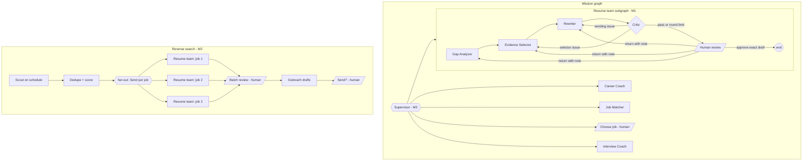

# Multi-agent plan: resume team and reverse job search

Branch: `feat/multi-agent-resume-team`. This plan covers two product directions on top of the existing CareerFlow mission workflow:

- **Direction 1 – resume × job tailoring:** a team of specialists that analyses a job, selects approved evidence, rewords it for the role and reviews the result before the user approves it.
- **Direction 4 – reverse job search:** a scheduled Scout that finds new public vacancies, shortlists them and prepares tailored application packages in parallel for one batch review.

Milestone M1 (the resume team with Command routing and targeted human returns) is implemented in this branch, together with save points, per-question interview rounds and the Quest interface (section 6a). M2 (Scout sweeps with parallel tailoring) is implemented apart from outreach drafts. M6 (per-call tracing and an evaluation set) is implemented; see [EVALUATION.md](EVALUATION.md). M3–M5 are designed here and have typed scaffolding where noted; they are not wired into the running mission.

## 1. Starting point

The existing mission is a fixed LangGraph pipeline with durable PostgreSQL checkpoints and three human pauses:

```
Career Coach -> Job Matcher -> [choose job] -> Resume Tailor -> [approve resume] -> Interview Coach -> [answers] -> feedback
```

Strengths kept as-is: pg-boss worker with leases, versioned profile approvals, evidence IDs on every claim, wording guard (`checkWording`), official employer APIs plus Adzuna and Tavily, fixture mode for offline checks, and a 60-call model budget per mission.

Gaps this plan addresses:

| Gap                                                                | Effect                                               | Addressed by                  |
| ------------------------------------------------------------------ | ---------------------------------------------------- | ----------------------------- |
| Specialists run in a fixed order and never hand work to each other | Looks like a pipeline, not collaboration             | M1 resume team, M3 supervisor |
| Graph state holds only `missionId`; no record of why work moved    | Collaboration is invisible to the user and in a demo | M1 handoff log                |
| Resume revision is one generic "revise" back to the start          | Human feedback is coarse; the whole draft is rebuilt | M1 targeted returns           |
| No automatic review before the human sees a draft                  | User does the quality control alone                  | M1 Critic loop                |
| Missions start only when the user asks                             | No proactive job search                              | M2 Scout + fan-out            |
| Pauses are fixed in code                                           | Agents guess instead of asking                       | M4 `ask_human`                |
| No traces or measured quality                                      | Hard to demonstrate or improve                       | M5 timeline, M6 evaluation    |

## 2. Target architecture



Design rules that every milestone follows:

1. **Orchestration state is not business data.** Graph state holds routing data (round counters, notes for the next specialist, handoffs). Drafts, gaps and critiques stay in the mission row, as before. Checkpoints never become a second copy of candidate evidence.
2. **Routing is explicit.** Specialists return `Command({ goto, update })`. Each transition is a recorded handoff with a reason, mirrored to `mission.data.resumeTeam.handoffs` and the Activity log.
3. **Deterministic guards decide facts; models propose.** A model can suggest wording or flag a weakness. Only approved fact IDs can become claims, and only wording that passes `checkWording` is accepted.
4. **Bounded loops and cost.** Critic rounds, human returns and model reviews have fixed limits, and all calls still count against `MISSION_MODEL_CALL_LIMIT`.
5. **Replay-safe pauses.** Interrupt nodes replay from the top on resume, so decision-dependent writes happen after `interrupt()` and approvals are idempotent by draft hash.
6. **Ports, not imports.** Subgraphs receive their database/provider work through a ports interface so their routing can be unit-tested with fakes and a real LangGraph runtime.

## 3. M1 – resume team (implemented)

### Specialists

| Specialist            | Reads                                         | Writes                                                                     | Guard                                                                                                                                                                                      |
| --------------------- | --------------------------------------------- | -------------------------------------------------------------------------- | ------------------------------------------------------------------------------------------------------------------------------------------------------------------------------------------ |
| **Gap Analyzer**      | Selected job, approved facts, user focus note | `resumeTeam.gaps`: requirement → supporting fact IDs, gaps, priority facts | Reuses the Job Matcher's source-quoted mapping in live mode; lexical whole-term match in fixture mode. Unknown fact IDs are dropped.                                                       |
| **Evidence Selector** | Approved facts, job, notes from Critic/user   | `resumeDraft` (new hash)                                                   | Original Resume Tailor selection. Critic/user-requested facts are added deterministically, only if eligible. `validateResumeClaims` rejects unknown or duplicate claims.                   |
| **Rewriter**          | Contribution claims in the draft, job, notes  | `resumeDraft` with `text` + `factText`, `resumeTeam.rewrites`              | Every proposal must pass `checkWording(fact, text)`: same numbers, qualifiers and source terms. Blocked wording keeps the verbatim fact. Headers, skills and education are never reworded. |
| **Critic**            | Draft, facts, gap report                      | `resumeTeam.critiques[]` with issues and metrics                           | Rule checks first (grounding, wording drift, omitted supported evidence). One model review per human cycle, only after the rules pass; model issues must reference real fact IDs.          |
| **Human review**      | Draft, critique, handoff log                  | Approval or a return to one specialist                                     | Decision bound to the exact draft hash; two returns per mission.                                                                                                                           |

### Routing

- `gap_analyzer → selector → rewriter → critic` by `Command` handoffs.
- `critic` passes → `human_review`. Selector issues → `selector` (re-selection invalidates wording, so it wins). Wording-only issues → `rewriter`. After `MAX_CRITIC_ROUNDS` (2) returns it escalates to `human_review` with the open issues visible instead of looping.
- `human_review`:
  - `approve` → persists the exact draft as an approved resume, then the parent graph continues to interview preparation.
  - `reject` + `target` + note → routes to that specialist only, with the note attached. Gap Analyzer notes are re-used as user focus and forwarded to the selector.
  - `revise` (legacy) → same as returning to the selector.

### State and data

Graph state (`ResumeTeamState`): `missionId`, `round`, `feedback` (notes for the next specialist, replaced on every handoff), `handoffs` (append reducer, last 60).

Mission data (`mission.data.resumeTeam`):

```ts
{
  gaps: GapReport;                 // requirements, priorityFactIds, gaps, userFocus
  rewrites: { accepted: number; blocked: { factId: string; reason: string }[] };
  critiques: Critique[];           // last 12, with metrics
  handoffs: Handoff[];             // mirror of graph state for the UI
  humanReturns: number;
  rewriterNotes?: string;
  modelReviewedCycle?: number;     // one model review per human cycle
}
```

### API and UI

- `POST /api/missions/:id/decisions` accepts `{ kind: 'resume', decision: 'reject', target: 'gap_analyzer' | 'selector' | 'rewriter', feedback, draftHash }`. A reject without a target or note is refused with `422 RETURN_TARGET_REQUIRED`; the existing two-revision limit covers returns too.
- The resume review aside shows a **Resume team review** panel: Critic verdict and metrics, open issues, unsupported requirements ("not evidenced, so not claimed"), the last eight handoffs and a "Send back to…" form.
- The existing manual edit and resume chat agent remain the "edit" path during review; they already enforce the same wording guard.

### Cost per review cycle

Worst case: selector 1 + rewriter 1 + critic model review 1, plus up to two more selector/rewriter rounds ≈ 7 model calls. With two human returns this stays inside the 60-call mission budget together with matching and interview steps. Fixture mode makes no model calls.

### Compatibility

The parent graph replaces `resume_tailoring` and `approve_resume` with a single `resume_team` subgraph node. Missions paused at the old `approve_resume` node on another branch cannot resume on this branch; start a new mission after switching.

## 4. Human-in-the-loop policy

| Gate             | When                                                            | User sees                                | User can                                                | Status        |
| ---------------- | --------------------------------------------------------------- | ---------------------------------------- | ------------------------------------------------------- | ------------- |
| Profile approval | Before any mission                                              | Proposed facts with source quotes        | Approve, edit, reject                                   | Existing      |
| Plan approval    | Supervisor proposes which teams/jobs to run and the call budget | Plan and estimated calls                 | Edit or drop steps                                      | M3            |
| Job choice       | After matching or a Scout sweep                                 | Score, quoted requirements, missing data | Choose, compare, ask Scout to re-search                 | Existing / M2 |
| Draft review     | After the Critic passes or escalates                            | Draft, wording diff, critique, handoffs  | Approve exact draft, edit, return to a named specialist | **M1**        |
| Batch review     | After parallel tailoring                                        | One package per job                      | Approve, return or discard each                         | M2            |
| Clarification    | A specialist lacks information or confidence                    | The question and why it matters          | Answer, or skip                                         | M4            |
| Outbound action  | Before any message or application leaves the app                | The exact text and recipient             | Send manually / copy; never auto-sent                   | M2            |

Risk rule: anything that creates a candidate claim, leaves the app, or spends beyond the plan needs a human decision. Low-risk internal steps (ranking, rewording within the guard) run automatically but stay visible in the handoff log.

## 5. M2 – Scout and reverse job search (implemented, except outreach drafts)

A sweep is its own checkpointed LangGraph (`packages/agents/src/scout/graph.ts`, thread `scout:<sweepId>`), separate from the mission graph:

```
Scout (collect) -> Job Matcher (rank) -> Send per shortlisted job -> tailor_job x K (parallel) -> report
```

- **Schedule:** one pg-boss schedule (`0 7 * * *`, `Australia/Sydney`) starts a sweep for every user who switched the daily sweep on. A sweep can also be started from the Scout page; at most six sweeps per user per day and one at a time.
- **Sources:** the saved search runs through the existing `JobRepository` (Greenhouse/Lever/Ashby official boards, Adzuna, optional Tavily discovery and web pages). No SEEK/LinkedIn scraping. A failed source is listed in the sweep and never replaced with demo roles.
- **Web pages:** the `web` source (`packages/recruitment/src/web-discovery.js`) runs one Tavily search with page text included, so the server never fetches a search-supplied URL. Pages are screened without a model (HTTPS only, 150–60,000 characters, posting wording, not a listing page), then at most eight (`WEB_PAGE_LIMIT`) are read by the `job-page` model role, one counted call each.
  - The model returns title, company and location with verbatim quotes. The server accepts a page only if each quote is literally on the page and contains its value; an unquoted location becomes "Not supplied". The description is the page's own text, never model-written.
  - SEEK, LinkedIn, Indeed, Glassdoor and Facebook are excluded, as are the Greenhouse/Lever/Ashby hosts the Tavily source already confirms. Web roles are labelled "web page · unverified vacancy" (`verified: false`); `auto` adds this source only in live mode with Tavily configured, and fixture mode never reads web pages.
- **Model web search:** the `agent` source (`packages/agents/src/job-search-agent.ts`, `packages/recruitment/src/agent-discovery.js`) is chosen explicitly and never runs under `auto`. The configured native OpenAI model runs its hosted `web_search` tool in one counted call (at most 40 tool calls) and reports up to 25 roles with links and quotes. Each claim is then checked on the server:
  - Links must be public HTTPS on a named host; internal-looking hosts are refused before any request.
  - A link to a board's search results page (for example an Indeed `/q-…-jobs.html` or a SEEK category page) is never read as the posting; the role becomes a lead whose reason says to find it by title on that page.
  - `robots.txt` is read first. A page the site forbids automated readers to fetch (SEEK job pages, LinkedIn, Indeed job pages) is never read; the role is kept as a **lead** with the model's quote and a link for the user to open.
  - Other pages are read through Tavily extract (at most 20) and must show the title and company with no closed notice; the description is then the page's own text. Pages that cannot be read also become leads.
  - Leads are stored in `TrackedJob` (`lead: true` with a reason) and shown with an "Open to check" link, but they are never scored or tailored on their own. Only checked roles reach the Job Matcher.
  - **Pasted leads:** the user opens a lead, copies the advertisement and pastes it on the Scout page (`POST /api/scout/leads/:fingerprint/package`, 200–20,000 characters). Scout scores the pasted text (one Job Matcher call in live mode), rebuilds the record's quoted fields from it, adds the role to that sweep's batch review and starts one package quest that stops at the draft review. The job is labelled as user-provided (`source.provider: 'lead'`, `liveVacancy: false`); one package per lead.
  - Measured against the Tavily `web` source in `docs/EVALUATION.md` ("Discovery comparison"). A live sweep on 2026-11-11 (graduate data analyst, Sydney): 14 searches, 15 roles reported, 3 pages checked, 11 leads, 1 rejected; 2 roles shortlisted and tailored; about 267k input tokens and 4.9 minutes in total.
- **Where Tavily fits now:** Tavily is the page reader behind model web search (the server never fetches a model-supplied page itself; only `robots.txt` is read directly) and stays required for that. Its own discovery sources, `tavily` (official Greenhouse/Lever/Ashby postings) and `web` (screened web pages), are kept as the low-cost tier: a few seconds and one search credit per sweep, but on 2026-11-11 they found 1 and 0 roles for the two comparison searches against 15 reported by model web search. They are still the only web discovery on a deployment without the native OpenAI route, and they back the deterministic screening evaluation. The Scout page labels the tiers and recommends model web search when the server supports it.
- **Dedupe:** `jobFingerprint` (normalised company | title | location) against the user's tracked roles and every role already shown in a quest shortlist, and across boards within the sweep.
- **Job records:** each new role is stored once in `TrackedJob` as a normalised record (`packages/contracts/src/job-record.ts`): work rights, working arrangement, level and salary converted to a yearly figure. Extraction is rule-based (no model call). Every field carries the sentence it came from; a field whose quote is not literally in the listing is dropped.
- **Scoring:** fixture mode uses the original matching baseline. Live mode screens by lexical overlap, then the Job Matcher maps requirements for at most six roles (`SCOUT_REVIEW_LIMIT`). A role whose mapping fails is left out and reported.
- **Fan-out:** `fanOutTailoring` returns one `Send('tailor_job', { sweepId, jobId })` per shortlisted role (top K, at most 3). Each branch starts a quest with that role already selected, so the resume teams run in parallel through the existing worker with their own leases, budgets and checkpoints. Branches write to a reducer channel and the port is idempotent per (sweep, job), so a retried sweep starts nothing twice.
- **Batch review:** the Scout page lists every package with its match score, quoted work-rights statement and state. A package quest skips the job choice and stops at the normal draft review: approve the exact draft, return it to a named specialist, or discard the package. Nothing is approved or sent automatically.
- **State boundary:** graph state holds the sweep ID, shortlisted job IDs, started packages and handoffs. Jobs, scores and records live in `ScoutSweep` and `TrackedJob`.
- **Not built yet:** outreach drafts (cover letter and referral message), model-based extraction for fields the rules cannot find, and re-checking tracked roles for removal or changes.

## 6. M3–M6

- **M3 – Supervisor.** `nextTeam(view)` in `orchestration/supervisor.ts` decides the next team from mission state (e.g. weak coverage → coach before tailoring). Later, a model planner proposes a plan that the user approves at the plan gate; the rule function executes it.
- **M4 – `ask_human`.** `askHuman()` in `orchestration/ask-human.ts` is an agent-initiated interrupt (`kind: 'clarification'`). Needs a queue status, a decision schema entry and a UI card.
- **M5 – Live timeline.** Stream `graph.stream(..., { streamMode: ['updates', 'custom'], subgraphs: true })` from the worker through SSE so the UI shows the active specialist and each handoff as it happens.
- **M6 – Observability and evaluation (implemented).** Every model call records one span (`TraceSpan`: agent, role, model, duration, requests, tokens, error class; never prompt or profile text) for missions and sweeps; `GET /api/missions/:id/trace` feeds the Battle log's cost-by-teammate table. LangGraph's own LangSmith tracing can be switched on by environment variable and is untested here. `npm run eval` measures record extraction, page screening and baseline ranking on a small fictional labelled set with regression floors in `tests/eval.test.ts`; `npm run eval:live` adds model-backed mapping, ranking and page reading. Not built: before/after resume-team metrics, critic pass rate and human return rate across runs. Original scope: Evaluation set of fictional profiles × public job ads with expected requirement links. Report: requirement coverage and keyword coverage before/after the team, critic pass rate by round, blocked-rewrite rate, human return rate and model calls per approved resume.

## 6a. Implemented beyond M1

- **Save points and branching.** `apps/api/src/save-points.ts` lists a mission's top-level checkpoints through LangGraph `getStateHistory` and can branch a new mission from two points: after the analysis (Job Matcher searches again) or before the job choice (same shortlist, different job). Saved results are copied into the new mission, so completed nodes skip on replay and no model call is repeated. Later checkpoints are not branchable because that would replay a human approval. A newer approved profile version blocks branching.
- **Interview rounds with an Evaluator.** `apps/api/src/interview-rounds.ts` scores each practice answer on the four STAR parts and asks at most one follow-up per question on the weakest part. It runs outside the graph on the locked mission row while the mission waits at `conduct_interview`; the Interview Coach still writes the final feedback. Fixture mode scores with labelled keyword rules. The live Evaluator has not been exercised on a real mission yet.
- **Quest interface.** `apps/web/src/quest/` is the default UI: Home, Quest log, mission header, job board, Party at work (resume review), Battle log, Save points, Boss battle, Character sheet, Party roster, World map and Season event. Every number is derived from stored records; values without a source are shown as planned or left out. The group's numbered-stage interface was removed on 2026-11-11; Quest is the only interface.

Not yet built from the design: source quotes and a work-rights column on the quest job board (the Scout page has them), a run comparison on Save points, realm rule packs on the World map, and the v1 requirement × evidence heatmap.

## 7. Evaluation and claims

Metrics are computed by `reviewDraft` on every round and stored with each critique, so before/after numbers come from real runs. Only quote numbers in a resume or demo after running the evaluation set; the fixture provider is deterministic and does not measure model quality.

## 8. Milestones

| ID  | Scope                                                                                | Acceptance                                                                                                               | Status                                                  |
| --- | ------------------------------------------------------------------------------------ | ------------------------------------------------------------------------------------------------------------------------ | ------------------------------------------------------- |
| M1  | Resume team subgraph, Command routing, Critic loop, targeted human returns, UI panel | Unit tests for routing, specialists and guards pass; typecheck passes; fixture mission reaches review with a handoff log | Implemented on this branch                              |
| M1+ | Save points with branching, per-question interview rounds, Quest interface           | Integration tests for branching and rounds; browser tests for the Quest pages                                            | Implemented on this branch                              |
| M2  | Scout schedule, dedupe, job records, fan-out, batch review                           | Graph and integration tests; one batch review covers the shortlisted jobs; nothing is sent automatically                 | Implemented on this branch; outreach drafts not built   |
| M3  | Supervisor routing and plan gate                                                     | Routing table tests; plan edits change the executed steps                                                                | Scaffolding + tests                                     |
| M4  | `ask_human` clarification pauses                                                     | Low-confidence step pauses with a question; answer resumes the same node                                                 | Scaffolding                                             |
| M5  | Streaming timeline                                                                   | Handoffs appear live during a mission                                                                                    | Planned                                                 |
| M6  | Per-call traces and evaluation report                                                | Trace endpoint and Battle log cost table; report generated from the evaluation set with regression floors                | Implemented; resume-team before/after metrics not built |

## 9. Tests

- `tests/resume-team.test.ts` – the real LangGraph runtime with fake ports: Critic → selector loop, rewriter-only routing, round-limit escalation, human return to a named specialist, gap-analyzer focus forwarding, interrupt payload and resume; plus gap analysis, critic rules and rewrite guard.
- `tests/orchestration-scaffold.test.ts` – supervisor rules, Scout dedupe, bounded fan-out, handoff history.
- `tests/scout-graph.test.ts` – the Scout graph on the real LangGraph runtime with fake ports: parallel `Send` branches, the reducer channel and the empty-shortlist route.
- `tests/scout.integration.test.ts` – a fixture-mode sweep end to end: records, parallel packages that stop at draft review, approval, and a second sweep that finds nothing new.
- `tests/job-record.test.ts` – quoted extraction, empty fields and salary conversion.

- `tests/integration.test.ts` – save-point listing and branching, interview rounds and follow-ups against the real graph in fixture mode.
- `tests/e2e/` – every spec runs against the Quest interface; `nav.ts` holds the top-bar and quest-route helpers.

Run with `npx vitest run tests/resume-team.test.ts tests/orchestration-scaffold.test.ts`. The full `npm run verify:local` also needs the portable database; `npm run test:e2e:local` runs the browser tests on a disposable database.

## 10. Known limits

- `checkWording` only allows reordering and removing filler. This is deliberate: the Rewriter can make claims clearer for a role but cannot make them stronger.
- The model Critic can disagree with itself across rounds; the round limit and once-per-cycle model review bound this.
- Scores and coverage are relevance signals, not hiring probabilities.
