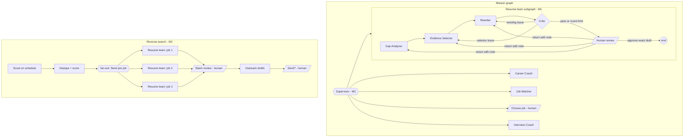

# Multi-agent plan: resume team and reverse job search

Branch: `feat/multi-agent-resume-team`. This plan covers two product directions on top of the existing CareerFlow mission workflow:

- **Direction 1 – resume × job tailoring:** a team of specialists that analyses a job, selects approved evidence, rewords it for the role and reviews the result before the user approves it.
- **Direction 4 – reverse job search:** a scheduled Scout that finds new public vacancies, shortlists them and prepares tailored application packages in parallel for one batch review.

Milestone M1 (the resume team with Command routing and targeted human returns) is implemented in this branch, together with save points, per-question interview rounds and the Quest interface (section 6a). M2–M6 are designed here and have typed scaffolding where noted; they are not wired into the running mission.

## 1. Starting point

The existing mission is a fixed LangGraph pipeline with durable PostgreSQL checkpoints and three human pauses:

```
Career Coach -> Job Matcher -> [choose job] -> Resume Tailor -> [approve resume] -> Interview Coach -> [answers] -> feedback
```

Strengths kept as-is: pg-boss worker with leases, versioned profile approvals, evidence IDs on every claim, wording guard (`checkWording`), official employer APIs plus Adzuna and Tavily, fixture mode for offline checks, and a 60-call model budget per mission.

Gaps this plan addresses:

| Gap | Effect | Addressed by |
|---|---|---|
| Specialists run in a fixed order and never hand work to each other | Looks like a pipeline, not collaboration | M1 resume team, M3 supervisor |
| Graph state holds only `missionId`; no record of why work moved | Collaboration is invisible to the user and in a demo | M1 handoff log |
| Resume revision is one generic "revise" back to the start | Human feedback is coarse; the whole draft is rebuilt | M1 targeted returns |
| No automatic review before the human sees a draft | User does the quality control alone | M1 Critic loop |
| Missions start only when the user asks | No proactive job search | M2 Scout + fan-out |
| Pauses are fixed in code | Agents guess instead of asking | M4 `ask_human` |
| No traces or measured quality | Hard to demonstrate or improve | M5 timeline, M6 evaluation |

## 2. Target architecture



Design rules that every milestone follows:

1. **Orchestration state is not business data.** Graph state holds routing data (round counters, notes for the next specialist, handoffs). Drafts, gaps and critiques stay in the mission row, as before. Checkpoints never become a second copy of candidate evidence.
2. **Routing is explicit.** Specialists return `Command({ goto, update })`. Each transition is a recorded handoff with a reason, mirrored to `mission.data.resumeTeam.handoffs` and the Activity log.
3. **Deterministic guards decide facts; models propose.** A model can suggest wording or flag a weakness. Only approved fact IDs can become claims, and only wording that passes `checkWording` is accepted.
4. **Bounded loops and cost.** Critic rounds, human returns and model reviews have fixed limits, and all calls still count against `MISSION_MODEL_CALL_LIMIT`.
5. **Replay-safe pauses.** Interrupt nodes replay from the top on resume, so decision-dependent writes happen after `interrupt()` and approvals are idempotent by draft hash.
6. **Ports, not imports.** Subgraphs receive their database/provider work through a ports interface so their routing can be unit-tested with fakes and a real LangGraph runtime.

## 3. M1 – resume team (implemented)

### Specialists

| Specialist | Reads | Writes | Guard |
|---|---|---|---|
| **Gap Analyzer** | Selected job, approved facts, user focus note | `resumeTeam.gaps`: requirement → supporting fact IDs, gaps, priority facts | Reuses the Job Matcher's source-quoted mapping in live mode; lexical whole-term match in fixture mode. Unknown fact IDs are dropped. |
| **Evidence Selector** | Approved facts, job, notes from Critic/user | `resumeDraft` (new hash) | Original Resume Tailor selection. Critic/user-requested facts are added deterministically, only if eligible. `validateResumeClaims` rejects unknown or duplicate claims. |
| **Rewriter** | Contribution claims in the draft, job, notes | `resumeDraft` with `text` + `factText`, `resumeTeam.rewrites` | Every proposal must pass `checkWording(fact, text)`: same numbers, qualifiers and source terms. Blocked wording keeps the verbatim fact. Headers, skills and education are never reworded. |
| **Critic** | Draft, facts, gap report | `resumeTeam.critiques[]` with issues and metrics | Rule checks first (grounding, wording drift, omitted supported evidence). One model review per human cycle, only after the rules pass; model issues must reference real fact IDs. |
| **Human review** | Draft, critique, handoff log | Approval or a return to one specialist | Decision bound to the exact draft hash; two returns per mission. |

### Routing

- `gap_analyzer → selector → rewriter → critic` by `Command` handoffs.
- `critic` passes → `human_review`. Selector issues → `selector` (re-selection invalidates wording, so it wins). Wording-only issues → `rewriter`. After `MAX_CRITIC_ROUNDS` (2) returns it escalates to `human_review` with the open issues visible instead of looping.
- `human_review`:
  - `approve` → persists the exact draft as an approved resume, then the parent graph continues to interview preparation.
  - `reject` + `target` + note → routes to that specialist only, with the note attached. Gap Analyzer notes are re-used as user focus and forwarded to the selector.
  - `revise` (legacy) → same as returning to the selector.

### State and data

Graph state (`ResumeTeamState`): `missionId`, `round`, `feedback` (notes for the next specialist, replaced on every handoff), `handoffs` (append reducer, last 60).

Mission data (`mission.data.resumeTeam`):

```ts
{
  gaps: GapReport;                 // requirements, priorityFactIds, gaps, userFocus
  rewrites: { accepted: number; blocked: { factId: string; reason: string }[] };
  critiques: Critique[];           // last 12, with metrics
  handoffs: Handoff[];             // mirror of graph state for the UI
  humanReturns: number;
  rewriterNotes?: string;
  modelReviewedCycle?: number;     // one model review per human cycle
}
```

### API and UI

- `POST /api/missions/:id/decisions` accepts `{ kind: 'resume', decision: 'reject', target: 'gap_analyzer' | 'selector' | 'rewriter', feedback, draftHash }`. A reject without a target or note is refused with `422 RETURN_TARGET_REQUIRED`; the existing two-revision limit covers returns too.
- The resume review aside shows a **Resume team review** panel: Critic verdict and metrics, open issues, unsupported requirements ("not evidenced, so not claimed"), the last eight handoffs and a "Send back to…" form.
- The existing manual edit and resume chat agent remain the "edit" path during review; they already enforce the same wording guard.

### Cost per review cycle

Worst case: selector 1 + rewriter 1 + critic model review 1, plus up to two more selector/rewriter rounds ≈ 7 model calls. With two human returns this stays inside the 60-call mission budget together with matching and interview steps. Fixture mode makes no model calls.

### Compatibility

The parent graph replaces `resume_tailoring` and `approve_resume` with a single `resume_team` subgraph node. Missions paused at the old `approve_resume` node on another branch cannot resume on this branch; start a new mission after switching.

## 4. Human-in-the-loop policy

| Gate | When | User sees | User can | Status |
|---|---|---|---|---|
| Profile approval | Before any mission | Proposed facts with source quotes | Approve, edit, reject | Existing |
| Plan approval | Supervisor proposes which teams/jobs to run and the call budget | Plan and estimated calls | Edit or drop steps | M3 |
| Job choice | After matching or a Scout sweep | Score, quoted requirements, missing data | Choose, compare, ask Scout to re-search | Existing / M2 |
| Draft review | After the Critic passes or escalates | Draft, wording diff, critique, handoffs | Approve exact draft, edit, return to a named specialist | **M1** |
| Batch review | After parallel tailoring | One package per job | Approve, return or discard each | M2 |
| Clarification | A specialist lacks information or confidence | The question and why it matters | Answer, or skip | M4 |
| Outbound action | Before any message or application leaves the app | The exact text and recipient | Send manually / copy; never auto-sent | M2 |

Risk rule: anything that creates a candidate claim, leaves the app, or spends beyond the plan needs a human decision. Low-risk internal steps (ranking, rewording within the guard) run automatically but stay visible in the handoff log.

## 5. M2 – Scout and reverse job search

- **Schedule:** pg-boss `schedule('scout-sweep', cron, { userId }, { tz: 'Australia/Sydney' })`, opt-in per user, at most daily.
- **Sources:** the existing `JobRepository` (Greenhouse/Lever/Ashby official boards, Adzuna, optional Tavily discovery). No SEEK/LinkedIn scraping.
- **Dedupe:** `jobFingerprint` (normalised company | title | location) against fingerprints already shown to the user, and across boards in the same sweep.
- **Scoring:** the Job Matcher mapping and score; shortlist top K (default 3) above a minimum score. One failing source is reported, not fatal.
- **Fan-out:** `fanOutTailoring` returns one `Send('tailor_job', { missionId, jobId })` per shortlisted job; each branch runs the resume team keyed by job, writing to a reducer channel keyed by `jobId`.
- **Batch review:** one interrupt listing every package; per-job approve/return/discard.
- **Outreach drafts:** cover letter and referral message drafted from approved claims only, shown for copy/send by the user.
- Scaffolding: `packages/agents/src/scout/scout.ts` (sweep logic, ports), `packages/agents/src/scout/fan-out.ts`.

## 6. M3–M6

- **M3 – Supervisor.** `nextTeam(view)` in `orchestration/supervisor.ts` decides the next team from mission state (e.g. weak coverage → coach before tailoring). Later, a model planner proposes a plan that the user approves at the plan gate; the rule function executes it.
- **M4 – `ask_human`.** `askHuman()` in `orchestration/ask-human.ts` is an agent-initiated interrupt (`kind: 'clarification'`). Needs a queue status, a decision schema entry and a UI card.
- **M5 – Live timeline.** Stream `graph.stream(..., { streamMode: ['updates', 'custom'], subgraphs: true })` from the worker through SSE so the UI shows the active specialist and each handoff as it happens.
- **M6 – Observability and evaluation.** LangSmith (or OpenTelemetry) traces per mission. Evaluation set of fictional profiles × public job ads with expected requirement links. Report: requirement coverage and keyword coverage before/after the team, critic pass rate by round, blocked-rewrite rate, human return rate and model calls per approved resume.

## 6a. Implemented beyond M1

- **Save points and branching.** `apps/api/src/save-points.ts` lists a mission's top-level checkpoints through LangGraph `getStateHistory` and can branch a new mission from two points: after the analysis (Job Matcher searches again) or before the job choice (same shortlist, different job). Saved results are copied into the new mission, so completed nodes skip on replay and no model call is repeated. Later checkpoints are not branchable because that would replay a human approval. A newer approved profile version blocks branching.
- **Interview rounds with an Evaluator.** `apps/api/src/interview-rounds.ts` scores each practice answer on the four STAR parts and asks at most one follow-up per question on the weakest part. It runs outside the graph on the locked mission row while the mission waits at `conduct_interview`; the Interview Coach still writes the final feedback. Fixture mode scores with labelled keyword rules. The live Evaluator has not been exercised on a real mission yet.
- **Quest interface.** `apps/web/src/quest/` is the default UI: Home, Quest log, mission header, job board, Party at work (resume review), Battle log, Save points, Boss battle, Character sheet, Party roster, World map and Season event. Every number is derived from stored records; values without a source are shown as planned or left out. The group interface remains at `?classic=1`.

Not yet built from the design: source quotes beside job fields and a work-rights column (needs the M2 job-record extraction), per-step tokens and latency in the Battle log (needs M6 tracing), a run comparison on Save points, realm rule packs on the World map, and the v1 requirement × evidence heatmap.

## 7. Evaluation and claims

Metrics are computed by `reviewDraft` on every round and stored with each critique, so before/after numbers come from real runs. Only quote numbers in a resume or demo after running the evaluation set; the fixture provider is deterministic and does not measure model quality.

## 8. Milestones

| ID | Scope | Acceptance | Status |
|---|---|---|---|
| M1 | Resume team subgraph, Command routing, Critic loop, targeted human returns, UI panel | Unit tests for routing, specialists and guards pass; typecheck passes; fixture mission reaches review with a handoff log | Implemented on this branch |
| M1+ | Save points with branching, per-question interview rounds, Quest interface | Integration tests for branching and rounds; browser tests for the Quest pages | Implemented on this branch |
| M2 | Scout schedule, dedupe, fan-out, batch review, outreach drafts | Sweep tests; one batch review covers three jobs; nothing is sent automatically | Scaffolding + tests |
| M3 | Supervisor routing and plan gate | Routing table tests; plan edits change the executed steps | Scaffolding + tests |
| M4 | `ask_human` clarification pauses | Low-confidence step pauses with a question; answer resumes the same node | Scaffolding |
| M5 | Streaming timeline | Handoffs appear live during a mission | Planned |
| M6 | Traces and evaluation report | Report generated from the evaluation set | Planned |

## 9. Tests

- `tests/resume-team.test.ts` – the real LangGraph runtime with fake ports: Critic → selector loop, rewriter-only routing, round-limit escalation, human return to a named specialist, gap-analyzer focus forwarding, interrupt payload and resume; plus gap analysis, critic rules and rewrite guard.
- `tests/orchestration-scaffold.test.ts` – supervisor rules, Scout dedupe and source-failure handling, bounded fan-out, handoff history.

- `tests/integration.test.ts` – save-point listing and branching, interview rounds and follow-ups against the real graph in fixture mode.
- `tests/e2e/` – Playwright project `classic` runs the group-interface specs at `?classic=1`; project `quest` covers the Quest pages.

Run with `npx vitest run tests/resume-team.test.ts tests/orchestration-scaffold.test.ts`. The full `npm run verify:local` also needs the portable database; `npm run test:e2e:local` runs the browser tests on a disposable database.

## 10. Known limits

- `checkWording` only allows reordering and removing filler. This is deliberate: the Rewriter can make claims clearer for a role but cannot make them stronger.
- The model Critic can disagree with itself across rounds; the round limit and once-per-cycle model review bound this.
- Scores and coverage are relevance signals, not hiring probabilities.
